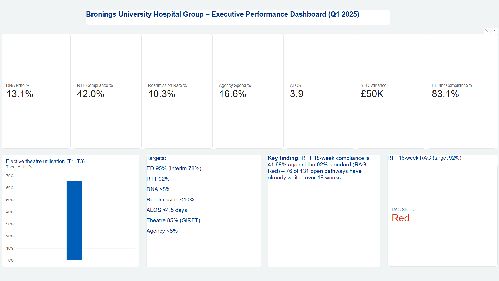
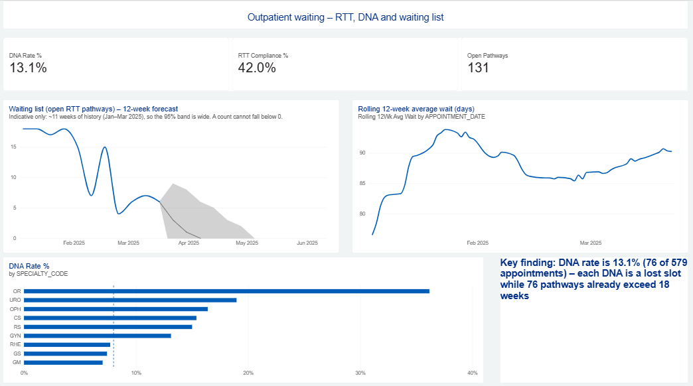
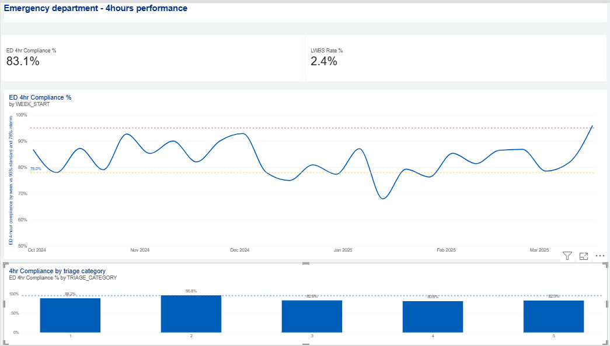
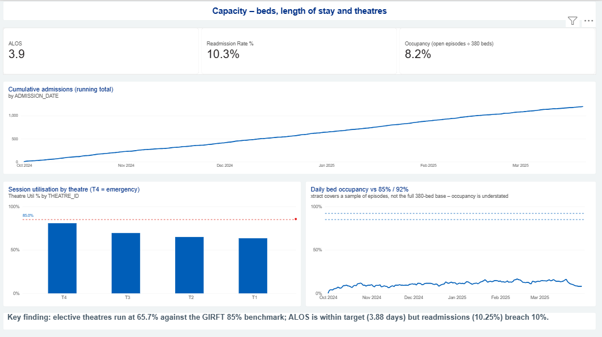
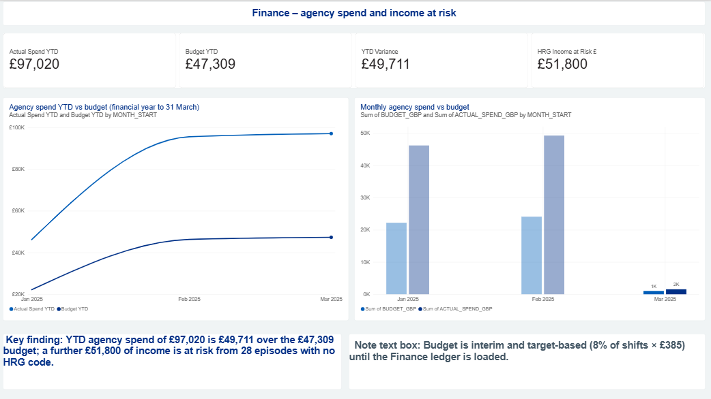
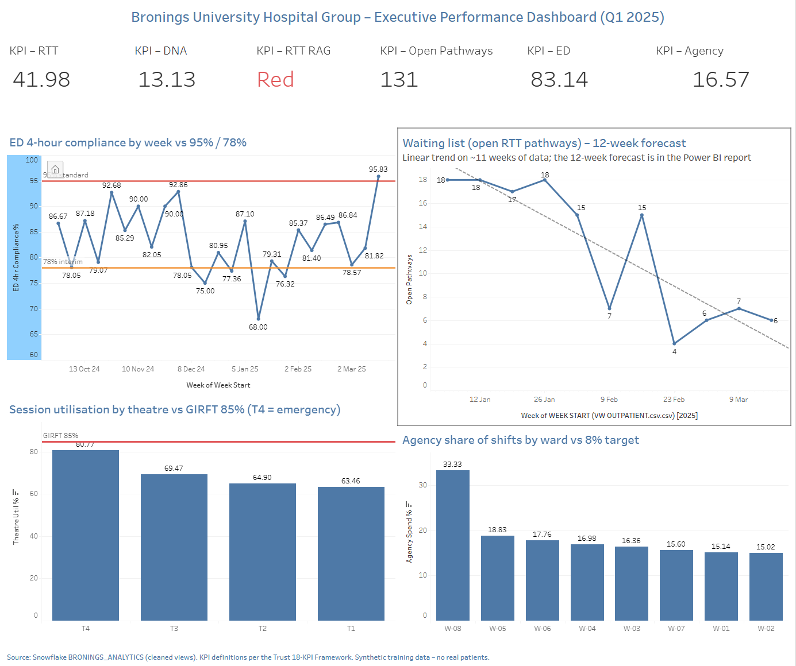

# Bronings University Hospital Group — Healthcare Analytics Portfolio

**Lucky Ukeni** · Healthcare Data Analyst · United Kingdom
[LinkedIn](https://www.linkedin.com/in/YOUR-PROFILE) · [Tableau Public](https://public.tableau.com/app/profile/lucky.ukeni)

An end-to-end NHS analytics project for **Bronings University Hospital Group**, a simulated NHS Foundation Trust in the East Midlands preparing for an NHS England review in March 2025. I audited five hospital datasets, investigated performance in SQL, agreed an 18-KPI framework, built Board dashboards in **Power BI and Tableau on Snowflake**, automated the weekly waiting-list report in **Python**, and presented the findings and a recovery plan to the Board.

The project follows the work an NHS Band 7 analyst would actually do. It starts with untrustworthy source data and conflicting figures in circulation: three different DNA rates, two theatre utilisation figures and a Board scorecard that had not been refreshed. It ends with one validated source, one agreed definition per KPI, automated weekly reporting and costed recommendations, all presented directly to the Board.

> All data is **synthetic training data**. No real patients are represented.

---

## Headline finding

**Only 41.98% of patients on an open RTT pathway were within 18 weeks** (76 of 131), against the 92% NHS standard. The Board had been told **74.8%**, a figure from a pivot table last refreshed in August 2024.

---

## Key findings

| Area | Finding |
|---|---|
| **RTT 18 weeks** | 41.98% vs 92%. 9 of 10 specialties Red. Orthopaedics 10.5% (17 of 19 breaching; longest wait 60.4 weeks) |
| **DNA rate** | Three conflicting figures (9.8%, 12.4%, 14.1%) replaced by one agreed definition: **13.1%** (76 ÷ 579) |
| **ED 4-hour** | 83.2% vs 95% (78% interim met). 39 blank breach flags, so the true figure is **79.9%–83.2%** |
| **Theatre utilisation** | Operations 64.2% vs Finance 71.6%, reconciled: the gap is T4 emergency theatre (+5 pts) and overruns (+1.6 pts). Gap to GIRFT 85% ≈ **£180,000/month** |
| **Income at risk** | 28 episodes with blank HRG codes = **£51,800** unbillable; 26 of them already have clinical codes (grouper not run) |
| **Workforce** | Agency on 16.6% of shifts vs 8% target: **£97,020 in 8 weeks**, 15–19% on every ward |
| **Patient safety / IG** | **16 NHS Numbers** linked to more than one person; no shared patient key across PAS, EHR and EDIS |
| **Data quality** | 63 issues logged; only **81.3%** of rows pass every check (ED 56.6%, Theatres 69.7%, Inpatients 79.9%) |
| **Readmissions** | 9.0% on recorded flags; **10.25%** with 44 blank flags back-filled using the 30-day rule |

### Recommendations to the Board
1. **Validate the full waiting list and treat the longest waiters, Orthopaedics first.** Avoids £126,000 of 52-week penalties (9 patients × £14,000).
2. **Recover elective theatre capacity towards GIRFT 85%.** Each +1 point ≈ £8,650/month; reaching 75% ≈ **£1.1m a year**.
3. **Fix the data that drives income.** HRG coding, ED and readmission flags, agency approval control: ≈ **£435,000 a year**, and protects the £380,000 CQUIN.

---

## Dashboards

**Power BI: Executive Summary** (6 pages, 12 DAX measures, Snowflake Import mode)


| Outpatient Waiting (12-week forecast) | Emergency Department |
|---|---|
|  |  |
| **Capacity** | **Finance** |
|  |  |

**Tableau Public: Executive Dashboard** · [View live](https://public.tableau.com/app/profile/lucky.ukeni/viz/BroningsExecutivePerformanceDashboard/ExecutiveDashboard)


Power BI, Tableau and Python all read the same cleaned Snowflake views, so every tool shows **RTT 41.98 · DNA 13.13 · ED 83.1 · Agency 16.57**.

---

## Tools used

| Tool | What I used it for |
|---|---|
| **Excel / Power Query** | Data quality audit (63 issues, severity, DQ scores), KPI research pack, DNA formula reconciliation |
| **SQL Server (T-SQL)** | Cleaned views; 12 investigation queries using CTEs, window functions (RANK, DENSE_RANK) and anti-joins |
| **Snowflake** | Warehouse, stage, COPY INTO, cleaned views as the single source of truth |
| **Power BI / DAX** | 6-page Board report: running total, rolling 12-week average, TOTALYTD variance, RAG logic, 12-week forecast |
| **Tableau Public** | Executive dashboard with reference lines, published publicly |
| **Python (pandas, openpyxl)** | Automated the 90-minute weekly exception report (now under 1 second), with DQ scoring across 5 datasets |
| **PowerPoint** | 12-slide Board presentation with speaker notes and prepared challenge answers |

---

## Repository structure

```
├── README.md
├── excel/          bronings_investigation.xlsx (DQ issue log, scores, workings) · bronings_kpi_research_pack.xlsx
├── sql/            bronings_sql_scripts.sql (load/clean views + 12 investigation queries)
├── snowflake/      snowflake_setup_queries.sql (warehouse, stage, COPY INTO, cleaned views)
├── powerbi/        bronings_dashboard.pbix · bronings_dax_measures.dax · NHS_Bronings_theme.json
├── tableau/        bronings_dashboard.twbx · tableau_public_url.txt · tableau_calculated_fields.txt
├── python/         bronings_automation.ipynb · run_weekly_report.py · sample_output_exception_report.xlsx
├── presentation/   bronings_board_presentation.pptx
├── docs/           discovery report · theatre reconciliation memo · SQL investigation report · 18-KPI framework
└── images/         dashboard screenshots
```

### Project phases
1. **Discovery:** stakeholder brief, Business Discovery Report, KPI research
2. **Data quality (Excel):** 63-issue log; DNA and theatre discrepancies explained
3. **SQL investigation:** 12 business questions answered in T-SQL
4. **KPI framework:** 18 agreed definitions, each with an owner, source, target and RAG thresholds
5. **Dashboards:** Snowflake → Power BI (6 pages) and Tableau Public
6. **Automation:** Python weekly exception report with DQ scoring
7. **Board presentation:** findings, recommendations with financial impact, challenge Q&A

### Running the Python notebook
Place the five CSV extracts in `python/data/`, then run all cells in `bronings_automation.ipynb`. The report is written to `python/output/`. Use `run_weekly_report.py` to schedule it (for example, Monday 07:00 via Task Scheduler or cron).

---

## Contact
**Lucky Ukeni** · MSc Management with Data Analytics · [LinkedIn](https://www.linkedin.com/in/YOUR-PROFILE) · [Tableau Public](https://public.tableau.com/app/profile/lucky.ukeni)
